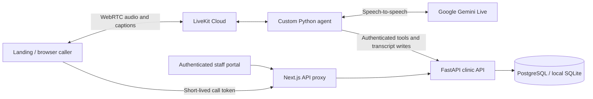

# ByteVoice Bangla

A Bangla voice receptionist for dental clinics and hospitals in Bangladesh, built for the StrategyByte AI Engineer assessment. The demo pairs **Fariya**, a custom LiveKit voice agent, with a product landing page and a protected staff workspace.

Fariya answers questions about **Mashrafi’s Dental**, a fictional clinic, and uses backend tools to book, reschedule and cancel appointments. Staff can review the conversation, captured patient details and saved actions in the portal.

## Try the demo

| Entry point | Purpose |
| --- | --- |
| [Landing page](https://bytevoice-bangla-portal.vercel.app/) | Product overview and live call button |
| [Staff portal](https://bytevoice-bangla-portal.vercel.app/portal) | Call records, transcripts, patient details and action history |
| [Standalone caller](https://bytevoice-bangla-portal.vercel.app/try) | Direct browser voice test |
| [API health](https://bytevoice-bangla-api.vercel.app/api/health) | Backend and storage status |

**Reviewer access** uses the username and password supplied privately with the submission. The username is prefilled on the login page. Credentials are excluded from this repository.

Use fictional patient details. Calls require microphone permission and last up to five minutes.

### Reviewer walkthrough

1. Open the landing page and choose **Talk to our Bangla caller**. The button starts a call and moves to the embedded demo controls.
2. Ask about a service or request an appointment in Bangla. Supply a fictional name and Bangladeshi mobile number, choose an available time, and confirm the readback.
3. Hear the saved booking reference. Use that reference and the same phone number to reschedule or cancel in a later call.
4. Sign in to the staff portal and select the matching call. Inspect **Conversation**, **Details** and **Activity**.
5. Open **Data structure** for the storage model, or **Voice test** for the same caller inside the workspace.

## What is implemented

- Bangla-first landing page with an English switch, responsive Glass Flower hero, live demo, clinic benefits, pricing contact and FAQ.
- Natural-language clinic enquiries, availability checks, confirmed bookings, verified lookup, rescheduling, cancellation and saved callback requests.
- Bangla/English digit normalization, individual-digit readbacks and explicit confirmation before appointment changes.
- Live conversation bubbles and an audio-reactive Mercury Orb shared by the public and staff voice tests.
- Searchable call records with separate call status and business outcome, timestamped transcripts, extracted details and action history.
- Protected staff routes, light/dark themes, Bangla/English controls and a collapsible desktop sidebar.
- Persistent PostgreSQL storage in deployment and SQLite for local development.

## Architecture



| Layer | Implementation |
| --- | --- |
| Web | Next.js 16, React 19, TypeScript, LiveKit browser SDK, Three.js / React Three Fiber |
| Voice worker | Python 3.13, LiveKit Agents, direct Google Gemini Live |
| Voice settings | `gemini-3.8-live`, Sulafat voice, Bangla instructions and native captions |
| Backend | FastAPI, SQLAlchemy, transactional appointment service |
| Storage | Supabase PostgreSQL in Mumbai, SQLite locally |
| Hosting | Vercel web/API and LiveKit Cloud worker in Mumbai |

The Google plugin supplies speech-to-speech and native caller/assistant captions. Google activity detection waits for 1,400 ms of silence with low end-of-speech sensitivity to allow pauses between digit groups. The prompt asks for calm Bangladeshi Bangla delivery and a consistent voice.

The previous LiveKit Inference route and optional Soniox → LLM → Azure pipeline remain configurable. They use separate provider credentials and allowances. The deployed route is selected explicitly with `REALTIME_PROVIDER=google`. Provider quotas still apply. [Provider migration and evidence](docs/google-direct.md)

## Booking and data integrity

`shared/clinic.json` supplies clinic facts, opening hours, services and booking rules. Appointment times are stored in UTC and presented in Asia/Dhaka.

- Availability comes from the backend. Slots are 30 minutes long within opening hours and a 14-day booking horizon.
- An active doctor/slot uniqueness constraint prevents double-booking.
- Booking writes and their action records commit together. A failed reschedule preserves the original appointment.
- Expected-version checks reject stale changes, and deterministic retry keys prevent duplicate operations.
- Lookup requires both the booking reference and the matching normalized mobile number.
- Partial details and transcripts are retained when a caller leaves before booking. Call lifecycle and business outcome are stored separately.
- A callback tool saves a demo follow-up request. It does not place a phone call or send a notification.

The demo uses one normalized mobile number as a patient identity. Shared family numbers are a known limitation. [Clinic and conversation rules](docs/clinic-spec.md)

## Local development

Use **Python 3.13** and **Node.js 24**, matching GitHub CI. The commands below use PowerShell from a fresh checkout.

### 1. Install dependencies and create local settings

```powershell
git clone https://github.com/ghostmash05/bytevoice-bangla-demo.git
Set-Location bytevoice-bangla-demo
python -m venv .venv
.\.venv\Scripts\python.exe -m pip install -r requirements-agent.txt
if (-not (Test-Path .env.local)) { Copy-Item .env.example .env.local }
.\.venv\Scripts\python.exe -m backend.setup_local
npm --prefix web ci
```

The setup command generates an agent API secret and hashes a reviewer password. Local login details are saved in ignored `.local/reviewer-credentials.txt`. Existing credentials are preserved.

Add your own **LiveKit URL, API key, API secret and Google API key** to the root `.env.local`. Use a development LiveKit project or a distinct `LIVEKIT_AGENT_NAME` for both the API and local worker so a local process does not compete with the hosted worker for the same dispatch.

The default provider settings in `.env.example` select direct Google inference with native captions. Separate Soniox/Azure credentials are needed only for the optional chained pipeline. Empty `DATABASE_URL` uses local SQLite.

### 2. Start the API

```powershell
.\.venv\Scripts\python.exe -m backend
```

### 3. Start the web app in another terminal

```powershell
Set-Location web
npm run dev
```

Open [localhost:3000](http://localhost:3000/). The web app proxies API requests to `http://127.0.0.1:8000` by default. Optional `web/.env.local` can set `BACKEND_URL` for another backend.

### 4. Start the voice worker in a third terminal

```powershell
.\.venv\Scripts\python.exe -m agent.config
.\.venv\Scripts\python.exe -m agent.main download-files
.\.venv\Scripts\python.exe -m agent.main dev
```

The configuration check reports missing variable names without printing secrets. A browser call needs all three processes and valid provider credentials.

Optional local fixtures can be created with `python -m backend.fixtures --confirm-test-data` using the virtual environment. They are labelled scripted fixtures and are separate from records created by voice calls.

## Authentication and privacy

The backend implements reviewer authentication with Argon2 password hashing, expiring server-side sessions, HttpOnly cookies and CSRF protection. Every `/portal` page validates the session on the server, including the data model and voice test. Safe internal return paths survive sign-in.

Agent tools use a separate server secret. The browser receives short-lived microphone-only room tokens. Google keys, database credentials and LiveKit project secrets stay on the server. Supabase hosts PostgreSQL, while staff authentication is handled by the application.

The application stores transcripts, extracted fields and appointment actions. Application audio recording is disabled. Synthetic test scripts may save generated audio locally. Provider retention and free-tier data policies should be considered before using any real information.

## Verification

The latest recorded checks include **53 Python tests**, **18 PostgreSQL booking tests**, the Next.js production build and **17 web authentication checks**.

Hosted synthetic calls exercised booking, rescheduling, cancellation, corrections, interruption, silence, farewell and saved callbacks. A phone-dictation test preserved all eleven digits across a one-second pause without agent speech during the gap. A human Safari tester reported successful booking and later preferred the calmer voice.

These are dated observations. Recognition, accent and voice consistency vary by speaker and call conditions. Synthetic audio tests and human reports are identified separately in the [verification record](docs/verification.md).

```powershell
.\.venv\Scripts\python.exe -m unittest discover -s tests -v
.\.venv\Scripts\python.exe -m pip check
npm --prefix web run typecheck
npm --prefix web run build
```

The authenticated smoke check uses local reviewer credentials, creates and revokes its own session, and leaves call records unchanged.

```powershell
.\.venv\Scripts\python.exe -m scripts.verify_web_auth https://bytevoice-bangla-portal.vercel.app
```

## Repository guide

| Path | Purpose |
| --- | --- |
| `agent/` | Voice prompt, registered tools, provider setup, captions, recovery and call ending |
| `backend/` | Authentication, HTTP API, validation, persistence and appointment transactions |
| `web/` | Landing page, browser caller and authenticated workspace |
| `shared/clinic.json` | Fictional clinic facts and booking rules |
| `tests/` | Isolated backend and agent regression tests |
| `scripts/` | Deployment preparation and explicit integration checks |
| `docs/` | Operations, verification, assessment requirements and handoff |

## Documentation

- [Deployment and operations](docs/deployment.md)
- [Accounts and environment setup](docs/accounts.md)
- [Verification record](docs/verification.md)
- [Technical brief cross-check](docs/task-brief-audit.md)
- [Submission checklist](docs/submission-readiness.md)
- [Optional demonstration outline](docs/demo-walkthrough.md)
- [Design system](DESIGN.md)

## Asset credits

The hero uses Paul Henschel’s [Glass Flower](https://github.com/pmndrs/examples/tree/ca032218ce77b7ad4c752ddaa63b0d1625d2b9f3/examples/glass-flower), with a [Poly Haven Blue Photo Studio HDRI](https://polyhaven.com/a/blue_photo_studio). The walkthrough uses the [Three.js Points Waves example](https://github.com/mrdoob/three.js/blob/r187/examples/webgl_points_waves.html).

The calling interface uses the original [VoiceOrbs Mercury Orb](https://voiceorbs.vercel.app/orbs/mercury-orb), vendored at revision `8b2799917734f52c9293a489e08982ca5b0187e9`. Its MIT license is included in `web/components/vendor/voiceorbs/LICENSE`. Model, decoder and scene license notices are in `web/public/landing/reference`. ByteVoice brand attribution is in [SOURCES.md](web/public/brand/SOURCES.md).
